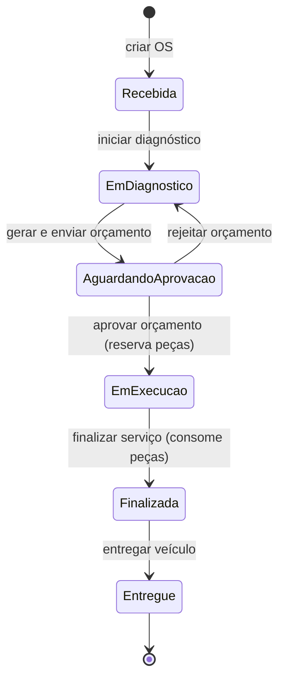

# Ordem de Serviço

Documentação DDD do contexto de Ordem de Serviço: Event Storming da criação e do acompanhamento, modelo
de domínio, regras de negócio, transações e a relação de cada elemento com o código. Termos em **negrito**
estão definidos na [Linguagem Ubíqua](./linguagem-ubiqua.md).

---

## 1. Event Storming

Legenda: 🟨 ator · 🟦 comando · 🟧 evento de domínio · 🟪 política · 🟩 agregado.

### 1.1 Criação da Ordem de Serviço

Atores: 🟨 **Cliente** e 🟨 **Atendente**. Agregados do quadro: 🟩 Cliente, 🟩 Veículo e 🟩 **Ordem de Serviço**.

| #   | Comando                           | Evento                      | Onde no código                                                                   |
| --- | --------------------------------- | --------------------------- | -------------------------------------------------------------------------------- |
| 1   | 🟦 Identificar cliente (CPF/CNPJ) | 🟧 Cliente identificado     | `CreateServiceOrderUseCase` busca o cliente por documento (consulta, sem evento) |
| 2   | 🟦 Cadastrar veículo              | 🟧 Veículo cadastrado       | `VehicleRegisteredEvent`, só quando a placa ainda não existe                     |
| 3   | 🟦 Criar ordem de serviço         | 🟧 OS criada (**Recebida**) | `ServiceOrder.create` → `ServiceOrderCreatedEvent`                               |
| 4   | 🟦 Adicionar serviço(s)           | 🟧 Serviço adicionado       | `ServiceOrder.addService` → `ServiceAddedEvent`                                  |
| 5   | 🟦 Adicionar peça(s)              | 🟧 Peça adicionada          | `ServiceOrder.addPart` → `PartAddedEvent`                                        |
| 6   | 🟦 Gerar orçamento                | 🟧 Orçamento gerado         | `ServiceOrder.sendBudget` → `BudgetGeneratedEvent`                               |
| 7   | 🟦 Enviar orçamento ao cliente    | 🟧 Orçamento enviado        | o mesmo comando → `BudgetSentEvent`                                              |
| 8   | 🟦 Aprovar orçamento              | 🟧 Orçamento aprovado       | `ServiceOrder.approveBudget` → `BudgetApprovedEvent`                             |

Políticas do quadro:

| Política                                         | Implementação                                                                                               |
| ------------------------------------------------ | ----------------------------------------------------------------------------------------------------------- |
| 🟪 Validar dados do cliente (CPF/CNPJ)           | `TaxDocument` e `taxDocumentSchema`: dígitos verificadores de CPF e de CNPJ (inclusive alfanumérico)        |
| 🟪 Verificar estoque antes de adicionar peça     | `AddPartToOrderUseCase` chama `Part.assertAvailable` com o **total** que a OS já pede daquela peça          |
| 🟪 Calcular o valor do orçamento automaticamente | `ServiceOrder.budgetTotal`: soma de serviços e peças (preço × quantidade), sempre atual; congelado no envio |

### 1.2 Acompanhamento da Ordem de Serviço

O quadro lista os comandos e deixa os eventos em branco. Eles ficam assim:

| Comando                         | Quem                                  | Evento                  | Status resultante          |
| ------------------------------- | ------------------------------------- | ----------------------- | -------------------------- |
| 🟦 Consultar status da OS (API) | 🟨 Cliente (sem login), 🟨 equipe     | — (consulta)            | —                          |
| 🟦 Iniciar diagnóstico          | 🟨 Mecânico                           | 🟧 Diagnóstico iniciado | **Em diagnóstico**         |
| 🟦 Iniciar execução             | 🟪 automático, ao aprovar o orçamento | 🟧 Execução iniciada    | **Em execução**            |
| 🟦 Finalizar serviço            | 🟨 Mecânico                           | 🟧 Serviço finalizado   | **Finalizada**             |
| 🟦 Entregar veículo             | 🟨 Atendente                          | 🟧 Veículo entregue     | **Entregue**               |
| 🟦 Rejeitar orçamento           | 🟨 Atendente, pela decisão do cliente | 🟧 Orçamento rejeitado  | volta a **Em diagnóstico** |

Políticas de acompanhamento:

| Política                                                | Implementação                                                                  |
| ------------------------------------------------------- | ------------------------------------------------------------------------------ |
| 🟪 Sempre que aprovar o orçamento, iniciar a execução   | `approveBudget` já inicia a execução: não existe rota para "iniciar execução"  |
| 🟪 Sempre que aprovar o orçamento, reservar as peças    | `ApproveBudgetUseCase` → `OrderStockService.reserve`, na mesma transação da OS |
| 🟪 Sempre que concluir o serviço, consumir as peças     | `FinishServiceUseCase` → `OrderStockService.consume`, na mesma transação da OS |
| 🟪 Sempre que o saldo ficar ≤ mínimo, alertar reposição | `MinimumStockReachedAlertHandler` (contexto de estoque), depois do commit      |

### 1.3 Status e transições

Os seis status são exatamente os da Fase 1. O status **nunca é escolhido por quem chama**: cada comando é
uma transição e o domínio recusa as demais (`INVALID_ORDER_TRANSITION`, HTTP 422). A tabela fica em
`OrderStatus.ts`; além dela, cada comando declara o status de origem, então "iniciar diagnóstico" não serve
para rejeitar um orçamento.

---

## 2. Modelo de domínio

### 2.1 Agregado `ServiceOrder`

Raiz de agregado e fronteira de consistência da OS. Reúne o cliente, o veículo, os itens, o orçamento e o
histórico, e é a única porta para alterá-los.

| Atributo                  | Tipo             | Significado                                                   |
| ------------------------- | ---------------- | ------------------------------------------------------------- |
| `customerId`, `vehicleId` | UUID             | Dono da OS e o veículo atendido (que pertence a esse cliente) |
| `status`                  | `OrderStatus`    | Um dos seis status                                            |
| `serviceItems`            | `ServiceItem[]`  | **Itens de Serviço**                                          |
| `partItems`               | `PartItem[]`     | **Itens de Peça**                                             |
| `budget`                  | `Budget \| null` | Só existe depois de enviado                                   |
| `budgetTotal`             | derivado         | Soma atual dos itens (o orçamento automático)                 |
| `history`                 | `StatusChange[]` | Cada status por que a OS passou, com data                     |
| `version`                 | inteiro          | Lock otimista                                                 |

### 2.2 Entidades (dentro do agregado)

| Entidade      | Regra                                                                                                                                                                             |
| ------------- | --------------------------------------------------------------------------------------------------------------------------------------------------------------------------------- |
| `ServiceItem` | Copia nome, preço e tempo estimado do catálogo na inclusão. Guarda `startedAt`/`finishedAt`; o **tempo de execução** é o intervalo entre eles. Não inicia nem conclui duas vezes. |
| `PartItem`    | Copia código, nome, unidade e preço unitário do estoque. Quantidade positiva, até 3 casas; inteira para itens em `UN`. O total da linha é preço × quantidade, ao centavo.         |

### 2.3 Objetos de valor

| Objeto de valor | Regra                                                                                                                      |
| --------------- | -------------------------------------------------------------------------------------------------------------------------- |
| `OrderStatus`   | Seis status, tabela de transições e a regra de edição (`isEditable`)                                                       |
| `Budget`        | Imutável: `send` cria pendente com o total congelado; `approve`/`reject` devolvem um novo valor e só valem uma vez         |
| `BudgetStatus`  | `PENDING`, `APPROVED`, `REJECTED`                                                                                          |
| `Money`         | Reais, até 2 casas, em centavos inteiros. `plus` e `multipliedBy(Quantity)` arredondam o meio centavo para cima, em BigInt |
| `Quantity`      | Até 3 casas, em milésimos inteiros                                                                                         |
| `TaxDocument`   | CPF ou CNPJ válido, sem máscara                                                                                            |
| `LicensePlate`  | Placa antiga ou Mercosul, sem hífen                                                                                        |

### 2.4 Eventos de domínio

`ServiceOrderCreatedEvent`, `ServiceAddedEvent`, `PartAddedEvent`, `BudgetGeneratedEvent`, `BudgetSentEvent`,
`BudgetApprovedEvent`, `BudgetRejectedEvent`, `DiagnosisStartedEvent`, `ExecutionStartedEvent`,
`ServiceOrderFinishedEvent` e `VehicleDeliveredEvent`. Todos no passado, publicados **depois** do commit.

### 2.5 Invariantes

1. A OS nasce **Recebida** e só muda de status pelos comandos da tabela de transições.
2. Serviços e peças só mudam enquanto a OS está **Recebida** ou **Em diagnóstico** (`ORDER_NOT_EDITABLE`).
   Depois do envio do orçamento, os itens e o total ficam congelados.
3. Um serviço aparece uma vez por OS. Uma peça também: incluí-la de novo **soma** a quantidade e mantém o
   preço da primeira inclusão.
4. Orçamento exige ao menos um serviço (`ORDER_WITHOUT_SERVICES`).
5. O total (e cada linha) nunca passa do limite monetário: o item que estouraria é recusado na inclusão,
   com a OS intacta.
6. O veículo da OS pertence ao cliente da OS.
7. Os preços ficam **congelados na inclusão**: editar o catálogo ou o estoque não altera OS existentes.
8. Todo comando valida antes de aplicar; uma falha nunca deixa a OS pela metade.

As invariantes de unicidade de itens, orçamento completo e quantidades positivas também são garantidas pelo
banco (índices únicos e `CHECK`), como última barreira.

---

## 3. Transações e concorrência

O pedido do desafio é "tratamento adequado das transações nos principais fluxos". Os fluxos que mexem em
mais de um agregado rodam numa única **unidade de trabalho** (`UnitOfWork`), implementada com uma
transação do PostgreSQL.

| Situação                                  | Tratamento                                                                                                                                                                                                                     |
| ----------------------------------------- | ------------------------------------------------------------------------------------------------------------------------------------------------------------------------------------------------------------------------------ |
| Aprovar orçamento                         | OS + reserva de todas as peças na **mesma transação**. Sem saldo para qualquer peça, nada é gravado: nem a OS muda, nem outra peça é reservada.                                                                                |
| Finalizar serviço                         | OS + consumo de todas as peças na mesma transação.                                                                                                                                                                             |
| Criar OS com veículo novo                 | Veículo + OS na mesma transação: não sobra veículo sem OS se a abertura falhar.                                                                                                                                                |
| Falha depois de gravar parte do trabalho  | A transação é desfeita por inteiro. Eventos só são publicados após o commit, então falha não gera evento.                                                                                                                      |
| Duas operações na mesma OS ao mesmo tempo | A OS é **travada ao ser carregada** dentro da unidade de trabalho (`SELECT … FOR UPDATE`): os comandos rodam um de cada vez e sempre leem a OS inteira e consistente. O `version` (lock otimista) segue como segunda barreira. |
| Conflito de versão (OS ou peça)           | A transação inteira é refeita (até 5 vezes, com espera aleatória) a partir de uma nova leitura: as regras são reavaliadas sobre o estado novo.                                                                                 |
| Duas aprovações da mesma OS               | Uma vale. A outra espera o bloqueio, lê a OS já **Em execução** e responde 422 `INVALID_ORDER_TRANSITION`; o estoque é reservado uma única vez.                                                                                |
| Duas OS disputando as últimas unidades    | Uma aprova; a outra recebe `INSUFFICIENT_STOCK`. O reservado nunca passa do saldo.                                                                                                                                             |
| Peças em ordem de id                      | Os lotes gravam as linhas na mesma ordem, evitando deadlock entre transações.                                                                                                                                                  |

Como funciona por baixo: `UnitOfWork.run` abre a transação e a deixa visível, por contexto assíncrono
(`AsyncLocalStorage`), aos repositórios chamados dentro dela. Os repositórios de OS, peça e veículo participam
dela sem receber parâmetro extra; fora de uma unidade de trabalho, funcionam como antes. O executor
`ServiceOrderCommandRunner` faz carregar → aplicar → gravar → publicar, com a retentativa por cima da
transação inteira.

---

## 4. API

| Método e rota                                 | Quem             | Comando / consulta                                 |
| --------------------------------------------- | ---------------- | -------------------------------------------------- |
| `POST /service-orders`                        | ADMIN, ATTENDANT | Identificar cliente, cadastrar veículo, criar OS   |
| `GET /service-orders`                         | autenticado      | Listar (filtros `status`, `customerId`, paginação) |
| `GET /service-orders/:id`                     | autenticado      | Detalhar: itens, orçamento, total e histórico      |
| `POST /service-orders/:id/services`           | autenticado      | Adicionar serviço                                  |
| `DELETE /service-orders/:id/services/:itemId` | autenticado      | Remover serviço (antes do envio)                   |
| `POST /service-orders/:id/parts`              | autenticado      | Adicionar peça (confere o estoque)                 |
| `DELETE /service-orders/:id/parts/:itemId`    | autenticado      | Remover peça (antes do envio)                      |
| `POST /service-orders/:id/diagnosis`          | ADMIN, MECHANIC  | Iniciar diagnóstico                                |
| `POST /service-orders/:id/budget/send`        | ADMIN, ATTENDANT | Gerar e enviar o orçamento                         |
| `POST /service-orders/:id/budget/approve`     | ADMIN, ATTENDANT | Registrar aprovação (inicia a execução, reserva)   |
| `POST /service-orders/:id/budget/reject`      | ADMIN, ATTENDANT | Registrar rejeição (volta ao diagnóstico)          |
| `POST /service-orders/:id/finish`             | ADMIN, MECHANIC  | Finalizar serviço (consome as peças)               |
| `POST /service-orders/:id/deliver`            | ADMIN, ATTENDANT | Entregar o veículo                                 |
| `GET /tracking/:id?document=`                 | **pública**      | Cliente acompanha a própria OS                     |
| `GET /reports/execution-time`                 | ADMIN            | Tempo médio de execução, geral e por serviço       |

### Acompanhamento pelo cliente

`GET /tracking/:id?document=<CPF ou CNPJ>` não exige login. O id da OS só responde junto com o documento do
dono; OS inexistente e documento de outro cliente dão o **mesmo** `404`, para não revelar quais ids existem.
A resposta traz status, veículo (placa, marca, modelo, ano), serviços, peças, total, orçamento e a linha do
tempo, sem `customerId`, `vehicleId` nem dados pessoais.

### Tempo médio de execução

O **tempo de execução** de um Item de Serviço é o intervalo entre o início (aprovação do orçamento) e a
conclusão (finalização da OS). O relatório calcula, direto no banco (`AVG` sobre aritmética de datas), a
média por OS concluída e, por serviço do catálogo, a média real ao lado da média estimada. Os itens de uma
mesma OS compartilham a janela de execução, porque o quadro só tem comandos para a OS inteira.

---

## 5. Decisões de modelagem

| Decisão                                                | Motivo                                                                                                                            |
| ------------------------------------------------------ | --------------------------------------------------------------------------------------------------------------------------------- |
| Rejeitar o orçamento devolve a OS a **Em diagnóstico** | A Fase 1 fixa seis status. O retorno permite revisar itens e reenviar, sem criar um sétimo status.                                |
| Aprovar **já inicia a execução**                       | Pela lista de status, aprovar leva a "Em execução"; "iniciar execução" do quadro vira política automática, sem rota própria.      |
| Aprovar e rejeitar são do atendente                    | A fase exige autenticação JWT nas APIs administrativas e só **consulta** pública pelo cliente. Aprovação pública ficaria exposta. |
| Reserva na aprovação, consumo na finalização           | É o contrato definido no contexto de estoque.                                                                                     |
| Preço congelado na inclusão                            | Pelo glossário do Event Storming: item de serviço e de peça têm preço congelado.                                                  |
| Gerar e enviar orçamento são um comando                | O total é calculado automaticamente a cada leitura; congelá-lo e enviá-lo é um único ato. Os dois eventos continuam existindo.    |
| Sem cancelamento de OS                                 | Não consta no Event Storming nem na Fase 1. `ReleasePartReservationsUseCase` fica pronto para quando existir.                     |
| Sem número sequencial da OS                            | O acompanhamento usa o id (UUID) mais o documento. Um número amigável é uma evolução possível.                                    |

---

## 6. Relação com o código

| Elemento                                   | Arquivo                                                                                                                                                                                                   |
| ------------------------------------------ | --------------------------------------------------------------------------------------------------------------------------------------------------------------------------------------------------------- |
| Agregado Ordem de Serviço                  | `src/domain/aggregates/ServiceOrder.ts`                                                                                                                                                                   |
| Entidades                                  | `src/domain/entities/{ServiceItem,PartItem}.ts`                                                                                                                                                           |
| Objetos de valor                           | `src/domain/value-objects/{OrderStatus,BudgetStatus,Budget,Money,Quantity}.ts`                                                                                                                            |
| Schemas                                    | `src/domain/schemas/{ServiceOrder,ServiceItem,PartItem,Budget}Schema.ts`                                                                                                                                  |
| Eventos de domínio                         | `src/domain/events/{ServiceOrderCreated,ServiceAdded,PartAdded,BudgetGenerated,BudgetSent,BudgetApproved,BudgetRejected,DiagnosisStarted,ExecutionStarted,ServiceOrderFinished,VehicleDelivered}Event.ts` |
| Repositório e unidade de trabalho (portas) | `src/domain/repositories/ServiceOrderRepository.ts`, `src/domain/providers/UnitOfWork.ts`                                                                                                                 |
| Casos de uso                               | `src/application/use-cases/service-orders/`                                                                                                                                                               |
| Executor de comandos (transação + retry)   | `src/application/services/ServiceOrderCommandRunner.ts`                                                                                                                                                   |
| Contrato com o estoque                     | `src/application/services/OrderStockService.ts`                                                                                                                                                           |
| Transação (Prisma)                         | `src/infrastructure/database/{TransactionContext,PrismaUnitOfWork}.ts`                                                                                                                                    |
| Repositório (Prisma, lock e relatório SQL) | `src/infrastructure/database/repositories/PrismaServiceOrderRepository.ts`                                                                                                                                |
| Schema e migration                         | `src/infrastructure/database/prisma/` (`ServiceOrder`, `OrderServiceItem`, `OrderPartItem`, `OrderStatusChange`)                                                                                          |
| Rotas HTTP                                 | `src/infrastructure/http/controllers/{ServiceOrder,ServiceOrderWorkflow,Tracking,Report}Controller.ts`                                                                                                    |
| Testes de domínio e aplicação              | `src/**/*.spec.ts`                                                                                                                                                                                        |
| Testes de integração (PostgreSQL)          | `PrismaServiceOrderRepository.integration.spec.ts`, `ServiceOrderController.integration.spec.ts`                                                                                                          |
